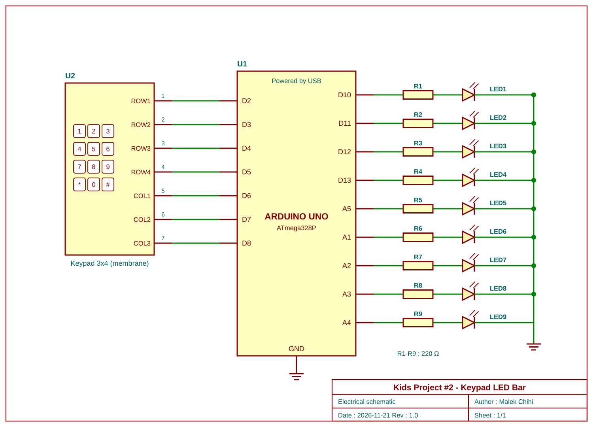

<div align="center">

# Kids Project #2 : Keypad LED Bar

**Press a number, light the same number of LEDs. Then play a counting game!**


</div>

---

## Overview

A 3x4 keypad controls a bar of 9 LEDs. The project has two modes:

| Key | Free mode (default) | Counting game |
|:-:|---|---|
| **1 - 9** | Lights the same number of LEDs | Your answer |
| **0** | Turns all LEDs OFF | Your answer |
| **\*** | Chaser animation (a light runs left and right) | Chaser animation |
| **#** | Starts the counting game | Back to free mode |

**Counting game:** the Arduino lights a random number of LEDs. Count them and type the answer.
Right answer: all LEDs blink and the score goes up. Wrong answer: the LEDs flash, try again.

**What you will learn:** matrix keypad scanning, digital outputs, arrays and loops, binary masks, random numbers, serial communication with Python.

---

## Components

| Component | Qty | Role |
|---|:-:|---|
| Arduino Uno | 1 | Microcontroller board |
| Keypad 3x4 (membrane, 7 pins) | 1 | User input |
| LED | 9 | LED bar |
| 220 Ω resistor | 9 | Limits the current (one per LED) |
| Breadboard + jumper wires | - | Connections |

---

## Wiring

### Schematic



### Connection table

| Component | Pin | Arduino |
|---|---|:-:|
| Keypad | Pins 1 to 4 (rows) | D2, D3, D4, D5 |
| Keypad | Pins 5 to 7 (columns) | D6, D7, D8 |
| LED 1 to LED 4 | Long leg (+) through 220 Ω | D10, D11, D12, D13 |
| LED 5 | Long leg (+) through 220 Ω | A5 |
| LED 6 to LED 9 | Long leg (+) through 220 Ω | A1, A2, A3, A4 |
| All LEDs | Short leg (-) | GND |

> **Note:** analog pins (A1 - A5) also work as normal digital outputs.

---

## Step 1 : Test each component

| Test | Checks | Expected result |
|---|---|---|
| [`Test_1_Keypad`](tests/Test_1_Keypad) | The keypad | Each key pressed appears in the Serial Monitor |
| [`Test_2_LEDs`](tests/Test_2_LEDs) | The 9 LEDs | The LEDs turn ON one by one |

> If a wrong key is displayed, your keypad has a different pin order: swap the numbers in `rowPins` / `colPins`.

---

## Step 2 : Build the project

1. Install the **Keypad** library: *Library Manager > search "Keypad" > Mark Stanley, Alexander Brevig > Install*.
2. Open [`Kids_Project_2_Keypad_LEDs.ino`](Kids_Project_2_Keypad_LEDs.ino) and upload it to the Arduino Uno.
3. Open the **Serial Monitor** at **9600 baud** to see the messages.

---

## Bonus : Python web interface

[`interface/keypad_web.py`](interface/keypad_web.py) opens a web page that mirrors the project in real time:
9 virtual LEDs, a virtual keypad that controls the real LEDs, the current mode and the game score.

```
pip install -r interface/requirements.txt
python interface/keypad_web.py
```

1. Close the Arduino IDE Serial Monitor (the USB port must be free).
2. The page opens at **http://localhost:8090**.
3. Choose the COM port and click **Connect**.

---

## No hardware? Simulate it

1. Go to [wokwi.com](https://wokwi.com) and create a new **Arduino Uno** project.
2. Replace the content of `diagram.json` with the one in this folder.
3. Add the **Keypad** library (*Library Manager* tab), paste the code into `sketch.ino` and click **Start**.

---

## How it works

**The keypad.** The 12 keys form a grid of 4 rows x 3 columns. Pressing a key connects one row to one column. The library scans every row/column pair to find the pressed key, so 7 wires are enough for 12 keys.

**From character to number.** The keypad returns a character (`'5'`), not a number. Each character has a code (`'0'` = 48, `'5'` = 53), so:

```
'5' - '0' = 53 - 48 = 5
```

**The LED mask.** The 9 LEDs are stored in one number, one bit per LED:

```
(1 << 3) - 1  =  000000111  ->  LEDs 1, 2, 3 ON
```

Every important line is explained in the code comments.

---

## Troubleshooting

| Problem | Solution |
|---|---|
| `Keypad.h: No such file or directory` | Install the Keypad library (Step 2). |
| `cannot open port COM3: Access denied` | The port is used by another program: close the Serial Monitor, the Python interface or other browser tabs. |
| Strange characters in the Serial Monitor | Set the Serial Monitor to **9600 baud**. |
| One LED always ON | Its leg is in the + rail of the breadboard or connected to 5V. Check its row. |
| `No module named 'nicegui'` | Install it with the same Python you use to run the script: `python -m pip install nicegui pyserial`. |
| Interface page shows "404" | Port 8080/8090 is used by another program: change the `port` value in the last line of `keypad_web.py`. |

---

## Project Structure

```
Kids_Project_2_Keypad_LEDs/
├── README.md
├── Kids_Project_2_Keypad_LEDs.ino   Main sketch
├── diagram.json                     Wokwi simulation
├── images/
│   ├── schematic.png
│   └── schematic.svg
├── interface/
│   ├── keypad_web.py                Python web interface
│   └── requirements.txt
└── tests/
    ├── Test_1_Keypad/
    └── Test_2_LEDs/
```

---

<div align="center">

[Back to all projects](../README.md) · Previous : [Kids Project #1](../Kids_Project_1_Radar)

**Malek Chihi** · [LinkedIn](https://www.linkedin.com/in/malekchihi) · [GitHub](https://github.com/ChihiMalek)

</div>
