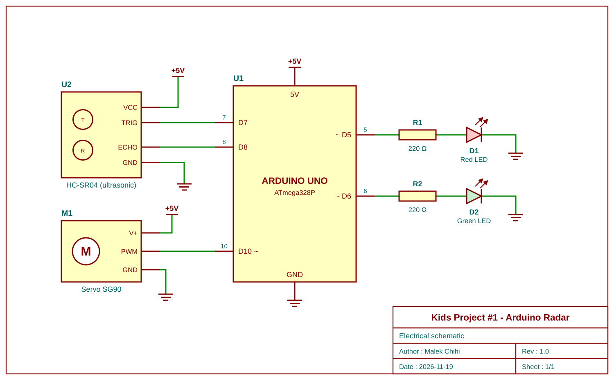
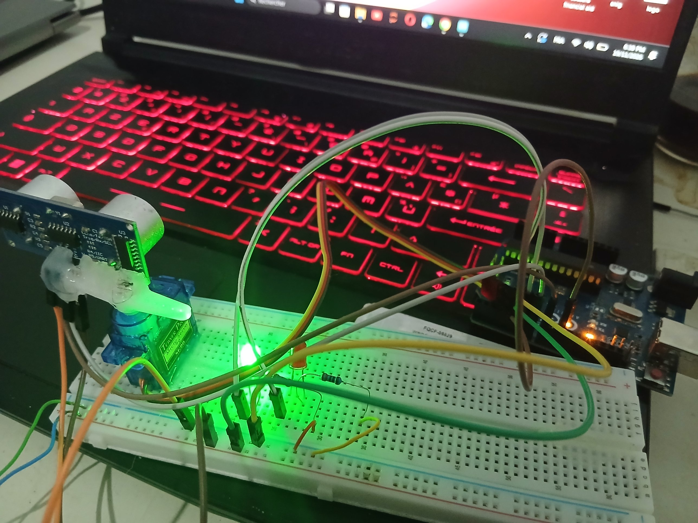

<div align="center">

# Kids Project #1 : Arduino Radar

**An ultrasonic sensor mounted on a servo motor scans its surroundings, like a real radar.**


</div>

---

## Overview

The servo motor sweeps from 10° to 170°. At each angle, the HC-SR04 sensor measures the distance to the nearest object.

| Situation | Result |
|---|---|
| Nothing within 20 cm | **Green LED** ON |
| Obstacle closer than 20 cm | **Red LED** ON |

**What you will learn:** ultrasonic distance measurement, servo motor control, digital outputs (LEDs), serial communication.

---

## Components

| Component | Qty | Role |
|---|:-:|---|
| Arduino Uno | 1 | Microcontroller board |
| SG90 servo motor | 1 | Rotates the sensor |
| HC-SR04 ultrasonic sensor | 1 | Measures the distance |
| Red LED | 1 | Obstacle alert |
| Green LED | 1 | All clear indicator |
| 220 Ω resistor | 2 | Limits the LED current |
| Breadboard + jumper wires | - | Connections |

---

## Wiring

### Schematic



### Connection table

| Component | Pin | Arduino |
|---|---|:-:|
| HC-SR04 | VCC / GND | 5V / GND |
| HC-SR04 | Trig | D7 |
| HC-SR04 | Echo | D8 |
| SG90 servo | Red / Brown | 5V / GND |
| SG90 servo | Yellow (signal) | D10 |
| Red LED | Long leg (+) through 220 Ω | D5 |
| Green LED | Long leg (+) through 220 Ω | D6 |
| Both LEDs | Short leg (-) | GND |

### Real build



> **Tip:** the sensor is fixed on the servo horn with hot glue. Never put glue on the motor shaft.

---

## Step 1 : Test each component

Before building the radar, test each component **on its own**. The test sketches are in the [`tests`](tests) folder.

| Test | Checks | Expected result |
|---|---|---|
| [`Test_1_Arduino`](tests/Test_1_Arduino) | The board receives code | The "L" LED blinks, the Serial Monitor counts |
| [`Test_2_LED`](tests/Test_2_LED) | Both LEDs | Red and green turn ON one after the other |
| [`Test_3_Servo`](tests/Test_3_Servo) | The servo motor | Moves to 0°, 90°, 180°, then back to 90° |
| [`Test_4_Ultrasonic`](tests/Test_4_Ultrasonic) | The HC-SR04 sensor | The distance changes when your hand moves |

---

## Step 2 : Build the radar

1. Open [`Kids_Project_1_Radar.ino`](Kids_Project_1_Radar.ino) in the **Arduino IDE**.
2. Select **Tools > Board > Arduino Uno** and the correct **COM port**.
3. Click **Upload**.
4. Open the **Serial Monitor** at **9600 baud** to see the angle and distance.

---

## Bonus : Radar screen

[`radar_screen.html`](radar_screen.html) displays the radar live in your browser. The zone turns **red** when an obstacle is detected.

1. Close the Arduino IDE (the USB port must be free).
2. Open `radar_screen.html` with **Google Chrome** or **Microsoft Edge**.
3. Click **Connect Arduino** and choose the COM port.

> The **Demo mode** button works without any hardware.

---

## No hardware? Simulate it

1. Go to [wokwi.com](https://wokwi.com) and create a new **Arduino Uno** project.
2. Replace the content of `diagram.json` with the one in this folder.
3. Paste the code into `sketch.ino` and click **Start**.
4. Click the sensor to change the obstacle distance.

---

## How it works

1. The **servo** turns from 10° to 170°, one degree at a time.
2. At each position, the **HC-SR04** sends an ultrasonic pulse. It bounces off the obstacle and comes back.
3. The Arduino measures the **round-trip time** and computes the distance:

```
distance (cm) = time (µs) × 0.0343 / 2
```

The division by 2 is needed because the sound travels **there and back**.

4. If the distance is below 20 cm, the **red LED** turns ON.

Every important line is explained in the code comments.

---

## Troubleshooting

| Problem | Solution |
|---|---|
| Upload error `not in sync` | Disconnect the servo during upload, check the COM port, try pressing RESET when "Uploading..." appears. |
| Sensor always shows 0 | Check Trig and Echo (swapped?) and the 5V. Use firmly inserted jumper wires. |
| Servo shakes or does not move | Check 5V and GND. Test the servo alone first. |
| An LED does not light up | It may be reversed: the long leg goes to the resistor. |
| Radar screen shows nothing | Close the Arduino IDE, then reconnect. Check that the baud rate is 9600. |

---

## Project Structure

```
Kids_Project_1_Radar/
├── README.md
├── Kids_Project_1_Radar.ino     Main sketch
├── radar_screen.html            Live radar display
├── diagram.json                 Wokwi simulation
├── images/
│   ├── schematic.png
│   ├── schematic.svg
│   └── wiring_photo.jpg
└── tests/
    ├── Test_1_Arduino/
    ├── Test_2_LED/
    ├── Test_3_Servo/
    └── Test_4_Ultrasonic/
```

---

<div align="center">

[Back to all projects](../README.md) · Next : **Kids Project #2** (coming soon)

**Malek Chihi** · [LinkedIn](https://www.linkedin.com/in/malekchihi) · [GitHub](https://github.com/ChihiMalek)

</div>
